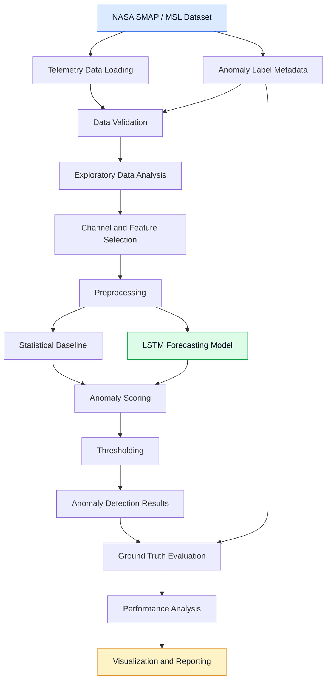
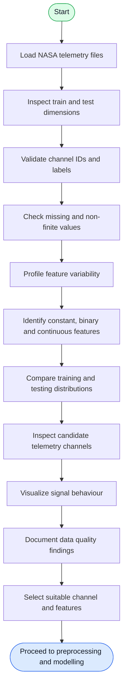

# AI-Powered Spacecraft Anomaly Detection

<p align="center">
  <strong>A Time-Series Machine Learning Research Project for Spacecraft Telemetry Analysis</strong>
</p>

<p align="center">
  
  
  
  
  
</p>

---

## 1. Project Overview

Spacecraft and planetary rovers continuously generate telemetry data through onboard sensors, instruments, and operational systems. These measurements provide information about the health and behaviour of spacecraft components.

Unexpected changes in telemetry signals may indicate abnormal system behaviour, sensor faults, or other operational irregularities.

**AI-Powered Spacecraft Anomaly Detection** is a machine learning research project focused on analysing spacecraft telemetry time series and identifying potentially anomalous patterns using statistical analysis and machine learning techniques.

The project uses NASA's Soil Moisture Active Passive (SMAP) and Mars Science Laboratory (MSL) telemetry anomaly benchmark datasets.

The intended approach combines:

- Exploratory data analysis and telemetry profiling.
- Statistical analysis and data preprocessing.
- Time-series forecasting.
- Prediction-error-based anomaly scoring.
- Dynamic anomaly thresholding.
- Point-level and event-level evaluation.
- Interactive visualization of detected anomalies.

The objective is to develop a reproducible and carefully evaluated anomaly detection pipeline rather than simply train a model and report an accuracy score.

## 2. Objectives

The major objectives of this project are:

1. Understand the structure and characteristics of NASA SMAP and MSL telemetry data.
2. Investigate channel-level and feature-level variability.
3. Identify constant, binary, and continuous telemetry features.
4. Examine training and testing distribution differences.
5. Develop a reliable preprocessing pipeline.
6. Establish statistical anomaly detection baselines.
7. Investigate LSTM-based time-series forecasting.
8. Calculate prediction errors and anomaly scores.
9. Explore adaptive thresholding strategies.
10. Evaluate detection performance using appropriate anomaly detection metrics.
11. Develop an interactive dashboard for telemetry visualization and anomaly analysis.

## 3. Dataset

<ins>NASA SMAP and MSL Telemetry Anomaly Benchmark</ins>

This project uses two publicly available spacecraft telemetry datasets:

| Dataset | Description |
|---|---|
| **SMAP** | Telemetry data from NASA's Soil Moisture Active Passive satellite. |
| **MSL** | Telemetry data from NASA's Mars Science Laboratory rover. |

The benchmark contains multivariate telemetry time series collected from different channels.

### Dataset components

- `train/` — Training telemetry arrays.
- `test/` — Testing telemetry arrays.
- `labeled_anomalies.csv` — Anomaly metadata and labelled test intervals.

### Data format

Telemetry arrays are stored as NumPy `.npy` files.

Each channel contains a time series with one or more features.

For example, the current G-6 investigation has the following observed dimensions:

| Split | Shape |
|---|---:|
| Training | 2,881 × 25 |
| Testing | 8,640 × 25 |

These dimensions describe the currently inspected G-6 channel, not the entire dataset.

### Anomaly labels

The benchmark provides anomaly intervals using start and end indices.

The project interprets an interval as:

\[
[start,\ end)
\]

This means the start index is included and the end index is excluded.

The benchmark also provides anomaly categories, including:

- Point anomalies.
- Contextual anomalies.

### Dataset source

The benchmark dataset is associated with the following research implementation:

- [NASA SMAP/MSL Telemetry Anomaly Detection Benchmark — Telemanom](https://github.com/khundman/telemanom)
- [NASA — Soil Moisture Active Passive Mission](https://smap.jpl.nasa.gov/)
- [NASA — Mars Science Laboratory](https://science.nasa.gov/mission/msl-curiosity/)

Please refer to the original dataset documentation for research attribution, dataset structure, and usage details.

### Dataset placement

After obtaining the dataset, arrange the files as follows:

```text
data/
└── raw/
    └── nasa_smap_msl/
        ├── train/
        │   ├── G-6.npy
        │   ├── E-1.npy
        │   └── ...
        ├── test/
        │   ├── G-6.npy
        │   ├── E-1.npy
        │   └── ...
        └── labeled_anomalies.csv
```

**Note:** Raw dataset files are excluded from Git tracking. They must be obtained separately and placed in the expected directory.

## 4. Project Architecture

The intended system architecture is illustrated below.



*This is the target architecture. Components shown as future modelling and evaluation stages are not yet claimed as implemented.*

## 5. Current Data Analysis Workflow

The current development focuses on understanding and validating the telemetry data before model development.



### Current exploratory analysis includes

- Training and testing dataset dimensions.
- Channel ID consistency checks.
- Label metadata validation.
- Feature uniqueness and variability analysis.
- Constant and near-constant feature identification.
- Statistical profiling using mean, standard deviation, median, minimum, and maximum.
- Quantile analysis.
- Non-finite value checks.
- Training versus testing signal comparison.
- Telemetry visualization.

Channel selection will be based on data quality, feature behaviour, and suitability for modelling—not simply on the number of available features.

## 6. Mathematical Foundations

The following mathematical methods form the planned analytical foundation of the project. Their inclusion documents the methodology under investigation; it does not imply that every method has already been implemented.

### 6.1 Z-Score Standardization

Standardization can be used to transform telemetry features to a comparable scale.

\[
z_t = \frac{x_t-\mu_{\text{train}}}{\sigma_{\text{train}}}
\]

Where:

- \(x_t\) = Current telemetry observation.
- \(\mu_{\text{train}}\) = Training mean.
- \(\sigma_{\text{train}}\) = Training standard deviation.
- \(z_t\) = Standardized telemetry value.

Training statistics should be used for both training and testing transformations to prevent data leakage.

### 6.2 Prediction Error

For forecasting-based anomaly detection, the difference between actual and predicted telemetry values can be used as an anomaly signal.

\[
e_t = x_t-\hat{x}_t
\]

Where:

- \(x_t\) = Actual observation.
- \(\hat{x}_t\) = Predicted observation.
- \(e_t\) = Prediction residual.

A large prediction error may indicate unusual telemetry behaviour.

### 6.3 Mean Absolute Error

\[
MAE = \frac{1}{N}\sum_{t=1}^{N}|x_t-\hat{x}_t|
\]

MAE measures the average absolute difference between actual and predicted values.

### 6.4 Mean Squared Error

\[
MSE = \frac{1}{N}\sum_{t=1}^{N}(x_t-\hat{x}_t)^2
\]

MSE penalizes larger prediction errors more heavily than smaller errors.

### 6.5 Anomaly Score

A potential multivariate anomaly score can be calculated using the mean squared prediction residual across \(d\) features:

\[
A_t = \frac{1}{d}\sum_{j=1}^{d}
(x_{t,j}-\hat{x}_{t,j})^2
\]

Where:

- \(A_t\) = Anomaly score at time step \(t\).
- \(d\) = Number of telemetry features.
- \(x_{t,j}\) = Actual value of feature \(j\).
- \(\hat{x}_{t,j}\) = Predicted value of feature \(j\).

Higher scores represent larger deviations from predicted behaviour.

### 6.6 Dynamic Thresholding

A threshold can be used to classify an observation as normal or anomalous.

\[
\hat{y}_t =
\begin{cases}
1, & A_t > \tau_t\\
0, & A_t \leq \tau_t
\end{cases}
\]

Where:

- \(\hat{y}_t\) = Predicted anomaly label.
- \(A_t\) = Anomaly score.
- \(\tau_t\) = Detection threshold.

A potential statistical threshold is:

\[
\tau = \mu_A + k\sigma_A
\]

Where:

- \(\mu_A\) = Mean anomaly score on reference training data.
- \(\sigma_A\) = Standard deviation of reference anomaly scores.
- \(k\) = Threshold sensitivity parameter.

The thresholding strategy will be selected after evaluating the anomaly score distribution and baseline performance. A fixed threshold and adaptive alternatives will be compared rather than assuming one approach is universally suitable.

### 6.7 Evaluation Metrics

The final detection system will be evaluated using:

**Precision**

\[
Precision = \frac{TP}{TP+FP}
\]

**Recall**

\[
Recall = \frac{TP}{TP+FN}
\]

**F1-Score**

\[
F1 = 2 \times
\frac{Precision \times Recall}
{Precision+Recall}
\]

**Where:**

- TP = True Positives.
- FP = False Positives.
- FN = False Negatives.

Point-level metrics will be supplemented with event-level evaluation because identifying an anomalous interval is not always equivalent to identifying every individual anomalous time step.

## 7. Planned Machine Learning Approach

### Statistical Baseline

A statistical baseline will provide a reference point before introducing more complex models.

Potential approaches include:

- Z-score-based detection.
- Rolling statistical analysis.
- Residual-based thresholding.

### LSTM-Based Forecasting

Long Short-Term Memory (LSTM) networks are designed to model sequential dependencies in time-series data.

The planned forecasting approach is:

1. Create sequential windows from historical telemetry.
2. Train an LSTM using normal training behaviour.
3. Predict subsequent telemetry observations.
4. Calculate prediction residuals.
5. Generate anomaly scores.
6. Apply a selected thresholding strategy.
7. Compare predictions with benchmark anomaly labels.

The LSTM cell uses the following core equations:

**Forget gate**

\[
f_t = \sigma(W_f[h_{t-1},x_t]+b_f)
\]

**Input gate**

\[
i_t = \sigma(W_i[h_{t-1},x_t]+b_i)
\]

**Candidate cell state**

\[
\tilde{C}_t = \tanh(W_C[h_{t-1},x_t]+b_C)
\]

**Cell state**

\[
C_t = f_t \odot C_{t-1}
+i_t \odot \tilde{C}_t
\]

**Output gate**

\[
o_t = \sigma(W_o[h_{t-1},x_t]+b_o)
\]

**Hidden state**

\[
h_t = o_t \odot \tanh(C_t)
\]

These equations describe the standard LSTM mechanism. The final model configuration, input window, architecture, and training parameters will be determined through experimentation.

## 8. Repository Structure

```text
Spacecraft-Anomaly-Detection/
│
├── app/
│   └── pages/
│
├── configs/
│
├── data/
│   ├── raw/
│   │   └── nasa_smap_msl/
│   │       ├── train/
│   │       ├── test/
│   │       └── labeled_anomalies.csv
│   │
│   └── processed/
│
├── models/
│
├── notebooks/
│
├── reports/
│   ├── figures/
│   └── results/
│
├── src/
│   ├── data/
│   │   ├── inspect_dataset.py
│   │   ├── inspect_channel.py
│   │   ├── inspect_candidate.py
│   │   ├── profile_channels.py
│   │   └── visualize_candidates.py
│   │
│   ├── detection/
│   ├── evaluation/
│   ├── models/
│   └── visualization/
│
├── tests/
│
├── .gitignore
├── LICENSE
├── README.md
└── requirements.txt
```

## 9. Technology Stack

| Category | Technologies |
|---|---|
| Programming Language | Python |
| Numerical Computing | NumPy, SciPy |
| Data Analysis | Pandas |
| Machine Learning | Scikit-learn |
| Deep Learning | PyTorch |
| Visualization | Matplotlib, Plotly |
| Dashboard | Streamlit |
| Experimentation | Jupyter Notebook, IPykernel |
| Configuration | PyYAML |
| Testing | Pytest |
| Version Control | Git, GitHub |

## 10. Installation and Setup

### Prerequisites

- Python 3.12 recommended.
- Git.
- VS Code or another Python development environment.
- NASA SMAP/MSL benchmark dataset.

### Step 1: Clone the repository

```bash
git clone https://github.com/Debankumardas/Spacecraft-Anomaly-Detection.git
```

```bash
cd Spacecraft-Anomaly-Detection
```

### Step 2: Create a virtual environment

**Windows PowerShell**

```powershell
python -m venv .venv
```

Activate the environment:

```powershell
.\.venv\Scripts\Activate.ps1
```

### Step 3: Install dependencies

```powershell
python -m pip install --upgrade pip
```

```powershell
pip install -r requirements.txt
```

### Step 4: Add the dataset

Place the NASA benchmark files inside:

```text
data/raw/nasa_smap_msl/
```

Ensure the `train`, `test`, and `labeled_anomalies.csv` files are available.

### Step 5: Inspect the dataset

Run the following commands from the project root:

```powershell
python .\src\data\inspect_dataset.py
```

Inspect a specific channel:

```powershell
python .\src\data\inspect_channel.py
```

Inspect the current candidate channel:

```powershell
python .\src\data\inspect_candidate.py
```

Profile telemetry channels:

```powershell
python .\src\data\profile_channels.py
```

Visualize candidate telemetry signals:

```powershell
python .\src\data\visualize_candidates.py
```

**Note:** The current inspection scripts have channel defaults defined inside their source files. Update those constants when investigating a different channel.

## 11. Development Roadmap

| Phase | Development Task | Status |
|---|---|---|
| 1 | Repository structure and environment setup | <ins>Completed</ins> |
| 2 | Dataset inspection and validation | In Progress |
| 3 | Channel and feature analysis | In Progress |
| 4 | Exploratory data visualization | In Progress |
| 5 | Data preprocessing pipeline | Planned |
| 6 | Statistical anomaly detection baseline | Planned |
| 7 | LSTM forecasting model | Planned |
| 8 | Anomaly scoring and threshold optimization | Planned |
| 9 | Point-level and event-level evaluation | Planned |
| 10 | Interactive Streamlit dashboard | Planned |
| 11 | Final experiments and documentation | Planned |

## 12. Research and Evaluation Considerations

A reliable anomaly detection system requires more than a high evaluation score.

This project will pay particular attention to:

- **Data leakage:** Test labels and test observations must not influence model training or threshold fitting.
- **Channel selection:** Candidate channels must be selected based on meaningful signal characteristics.
- **Distribution shift:** Training and testing telemetry may have different statistical distributions.
- **Class imbalance:** Anomalous observations may represent only a small fraction of the test sequence.
- **False alarms:** Excessive false positives can make anomaly detection impractical.
- **Event detection:** Consecutive anomalous observations should be assessed as events as well as individual points.
- **Reproducibility:** Experiments, configurations, and evaluation results should be documented.
- **Model comparison:** Complex models should be compared against simpler statistical baselines.

## 13. Current Project Status

<ins>Under Active Development</ins>

The current development stage is focused on dataset understanding and telemetry signal investigation.

Work currently includes:

- Establishing the project structure and Python environment.
- Inspecting NASA SMAP/MSL training and testing arrays.
- Validating anomaly label metadata.
- Profiling telemetry channels and feature variability.
- Investigating candidate channels, including G-6.
- Comparing training and testing signal characteristics.
- Building initial telemetry visualization scripts.

Model training, final channel selection, anomaly detection performance, and dashboard functionality are not yet finalized.

## 14. Limitations and Disclaimer

This is an educational and research-oriented machine learning project based on historical NASA telemetry benchmark data.

It is not a certified spacecraft monitoring system and must not be used for real spacecraft operations, flight decisions, or safety-critical applications.

Detection results will depend on data quality, model assumptions, channel selection, and evaluation methodology.

## 15. Future Improvements

Potential future extensions include:

- Multivariate anomaly detection.
- Comparison of statistical and deep learning approaches.
- Adaptive threshold optimization.
- Detection of contextual and point anomalies.
- Model explainability and anomaly interpretation.
- Improved event-level detection.
- Interactive telemetry monitoring dashboard.
- Reproducible experiment reports.

## 16. Author

**Deban Kumar Das D**

BCA Data Science Student | Machine Learning | Artificial Intelligence

- GitHub: [@Debankumardas](https://github.com/Debankumardas)
- LinkedIn: [debankumardasd](https://www.linkedin.com/in/debankumardasd/)

---

<p align="center">
  <strong>From telemetry signals to intelligent anomaly detection.</strong>
  <br>
  <sub>Built through research, experimentation, and continuous evaluation.</sub>
</p>
