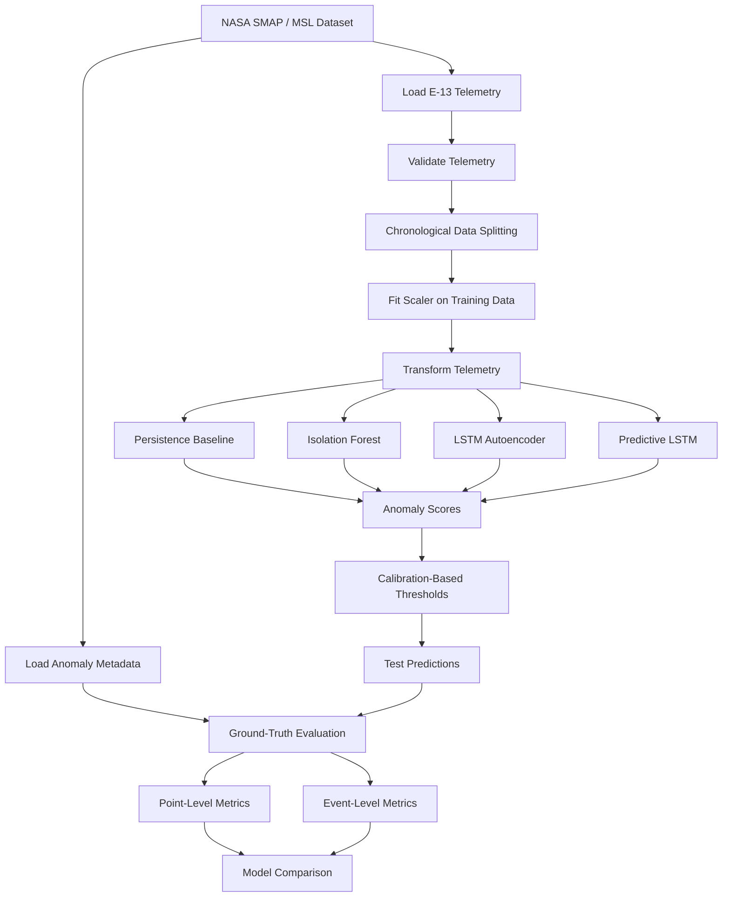
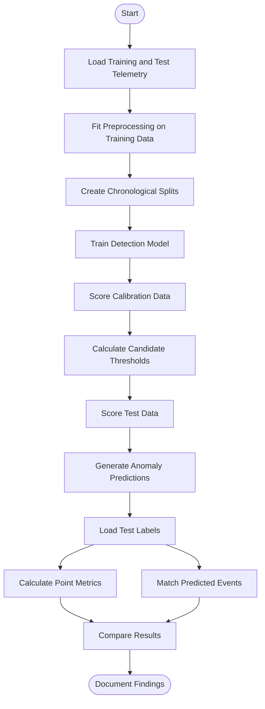

# AI-Powered Spacecraft Anomaly Detection

<p align="center">
  <strong>A Time-Series Machine Learning Research Project for Spacecraft Telemetry Analysis</strong>
</p>

<p align="center">
  
  
  
  
  
  
</p>

---

## 1. Project Overview

Spacecraft continuously generate telemetry through onboard sensors and operational systems. These measurements provide information about the behaviour and condition of spacecraft components.

Unexpected changes in telemetry may indicate abnormal operating conditions, sensor faults, or other irregular behaviour. Detecting such patterns is an important time-series analysis problem.

**AI-Powered Spacecraft Anomaly Detection** is a machine learning research project that investigates statistical and deep learning approaches for identifying anomalous patterns in spacecraft telemetry.

The project uses the NASA Soil Moisture Active Passive (SMAP) and Mars Science Laboratory (MSL) telemetry anomaly benchmark. The current experimental implementation focuses on the **E-13 channel**.

The research compares multiple approaches rather than assuming that a complex neural network will outperform simpler methods.

### Implemented approaches

- Persistence-based baseline.
- Isolation Forest anomaly detection.
- LSTM Autoencoder reconstruction-error detection.
- Predictive LSTM next-step forecasting.
- Training-only data normalization.
- Chronological training, validation and calibration splits.
- Calibration-based anomaly threshold selection.
- Point-level and event-level evaluation.
- Automated unit and integration testing.

The primary objective is to build a reproducible evaluation pipeline and understand the strengths and limitations of different anomaly detection methods.

## 2. Project Objectives

1. Understand the structure of NASA SMAP/MSL telemetry.
2. Investigate multivariate time-series behaviour.
3. Build a reliable preprocessing pipeline.
4. Prevent data leakage during model development.
5. Establish simple anomaly detection baselines.
6. Implement machine learning and LSTM-based approaches.
7. Generate anomaly scores from telemetry observations.
8. Calibrate detection thresholds without using test labels.
9. Evaluate point-level and event-level detection performance.
10. Compare models using consistent evaluation procedures.
11. Document experimental limitations and potential improvements.

## 3. Dataset

### NASA SMAP and MSL Telemetry Anomaly Benchmark

The project uses the NASA SMAP/MSL telemetry anomaly benchmark associated with the Telemanom research implementation.

| Dataset | Description |
|---|---|
| SMAP | Telemetry collected from NASA's Soil Moisture Active Passive satellite |
| MSL | Telemetry collected from NASA's Mars Science Laboratory |

The benchmark contains multivariate time-series channels and labelled anomaly intervals.

### Current experimental channel: E-13

| Property | Value |
|---|---:|
| Channel | E-13 |
| Training observations | 2,880 |
| Testing observations | 8,640 |
| Telemetry features | 25 |
| Anomalous test observations | 264 |
| Normal test observations | 8,376 |
| Ground-truth anomaly intervals | 3 |

The current experiment uses 25 telemetry features for each observation.

### Dataset components

- `train/` — Training telemetry arrays.
- `test/` — Testing telemetry arrays.
- `labeled_anomalies.csv` — Channel-level anomaly metadata and labelled test intervals.

Telemetry arrays are stored in NumPy `.npy` format.

### Anomaly interval convention

The E-13 experiment uses zero-based, inclusive anomaly intervals:

\[
[start,\ end]
\]

For example, an interval `[5309, 5410]` includes both index 5309 and index 5410.

The three E-13 anomaly intervals are:

| Interval | Start index | End index | Length |
|---|---:|---:|---:|
| 1 | 5309 | 5410 | 102 |
| 2 | 5600 | 5640 | 41 |
| 3 | 6449 | 6569 | 121 |
| **Total** | | | **264** |

### Dataset source

- [Telemanom — NASA SMAP/MSL Telemetry Anomaly Detection](https://github.com/khundman/telemanom)
- [NASA — Soil Moisture Active Passive Mission](https://smap.jpl.nasa.gov/)
- [NASA — Mars Science Laboratory](https://science.nasa.gov/mission/msl-curiosity/)

Refer to the original benchmark documentation for dataset attribution and usage details.

### Dataset placement

After obtaining the dataset, arrange the files as follows:

```text
data/
├── raw/
│   └── nasa_smap_msl/
│       ├── train/
│       ├── test/
│       └── labeled_anomalies.csv
└── processed/
    ├── E-13_train.npy
    └── E-13_test.npy
```

Raw benchmark files are excluded from Git tracking and must be obtained separately.

## 4. System Architecture

The current experimental pipeline follows this workflow:



### Evaluation workflow



## 5. Data Preprocessing and Leakage Prevention

A reliable evaluation requires strict separation between model development and final test evaluation.

### Chronological data splitting

The training telemetry is divided chronologically:

| Partition | Proportion |
|---|---:|
| Model-fitting data | 80% |
| Validation data | 20% |

The first 80% is used for model fitting and preprocessing statistics. The remaining 20% is used for validation and threshold calibration.

The test sequence is kept separate from model training and threshold fitting.

### Normalization

The scaler is fitted exclusively on the chronological training-fitting partition.

The same fitted scaler is then used to transform validation, calibration and test observations.

This prevents information from future observations from influencing preprocessing parameters.

### Sequence construction

The LSTM models use a sequence length of 30 observations.

Each sequence contains 29 historical observations and one target observation.

For validation, calibration and test data, the preceding 29 observations are supplied as context so that sequence construction does not unnecessarily discard the first observations of each partition.

The sequence generator validates input dimensionality, sequence length and finite numerical values.

## 6. Machine Learning Models

### 6.1 Persistence Baseline

The persistence approach provides a simple reference model.

It uses recent telemetry behaviour as a baseline for comparison with more sophisticated approaches.

Its purpose is to establish whether additional model complexity produces measurable improvement.

### 6.2 Isolation Forest

Isolation Forest is an unsupervised anomaly detection algorithm based on randomly partitioning observations.

Anomalous observations are generally isolated using fewer partitions than ordinary observations.

The algorithm produces an anomaly score that can be compared with a threshold.

This approach provides a non-neural machine learning baseline.

### 6.3 LSTM Autoencoder

The LSTM Autoencoder learns to reconstruct telemetry sequences.

Its architecture contains:

- An LSTM encoder with 25 input features and 32 hidden units.
- An LSTM decoder with 32 hidden units.
- A linear output layer with 25 reconstructed features.

The model is trained using mean squared reconstruction loss.

For the current anomaly scoring implementation, the reconstruction error is calculated using the final observation of each sequence.

\[
A_t = \frac{1}{d}\sum_{j=1}^{d}
(x_{t,j}-\hat{x}_{t,j})^2
\]

Where:

- \(A_t\) is the anomaly score at time \(t\).
- \(d\) is the number of telemetry features.
- \(x_{t,j}\) is the actual feature value.
- \(\hat{x}_{t,j}\) is the reconstructed feature value.

A larger reconstruction error indicates a larger difference between the actual and reconstructed observation.

**Important limitation:** The target observation is part of the input sequence. The model can therefore learn to reconstruct anomalous observations, potentially producing low reconstruction errors for some anomalies.

### 6.4 Predictive LSTM

Unlike the autoencoder, the predictive LSTM predicts the next telemetry observation from previous observations.

The model receives the first 29 observations in a sequence and predicts the 30th observation.

The final target is not exposed to the model before prediction.

The anomaly score is the mean squared prediction error across all 25 features:

\[
E_t = \frac{1}{25}\sum_{j=1}^{25}
(x_{t,j}-\hat{x}_{t,j})^2
\]

Where:

- \(E_t\) is the prediction-error anomaly score.
- \(x_{t,j}\) is the actual target value.
- \(\hat{x}_{t,j}\) is the predicted target value.

The model uses an LSTM encoder and a linear prediction head.

### LSTM architecture fundamentals

The standard LSTM mechanism uses the following gates:

**Forget gate**

\[
f_t = \sigma(W_f[h_{t-1},x_t]+b_f)
\]

**Input gate**

\[
i_t = \sigma(W_i[h_{t-1},x_t]+b_i)
\]

**Candidate cell state**

\[
\tilde{C}_t = \tanh(W_C[h_{t-1},x_t]+b_C)
\]

**Cell state**

\[
C_t = f_t \odot C_{t-1}
+i_t \odot \tilde{C}_t
\]

**Output gate**

\[
o_t = \sigma(W_o[h_{t-1},x_t]+b_o)
\]

**Hidden state**

\[
h_t = o_t \odot \tanh(C_t)
\]

These equations describe the standard LSTM mechanism used to model sequential dependencies.

## 7. Anomaly Thresholding

Anomaly scores are converted into binary predictions using thresholds calculated from calibration scores.

The project investigates the following candidate thresholds:

- 95th percentile.
- 97.5th percentile.
- 99th percentile.
- Mean plus three standard deviations.

### Percentile threshold

\[
\tau_q = Q_q(A_{\text{calibration}})
\]

Where \(Q_q\) is the selected percentile of the calibration anomaly-score distribution.

### Mean plus three standard deviations

\[
\tau = \mu_A + 3\sigma_A
\]

Where:

- \(\mu_A\) is the mean calibration anomaly score.
- \(\sigma_A\) is its standard deviation.

### Anomaly decision

\[
\hat{y}_t =
\begin{cases}
1, & A_t > \tau \\
0, & A_t \leq \tau
\end{cases}
\]

A prediction of 1 represents an anomaly alert.

**Important:** Thresholds are calculated from calibration scores, not from test labels. Test labels are reserved for final evaluation.

The mean-plus-three-standard-deviations threshold is sensitive to extreme scores. It should not automatically be treated as the best threshold.

## 8. Evaluation Methodology

The project uses both point-level and event-level evaluation.

### Point-level evaluation

**Precision**

\[
Precision = \frac{TP}{TP+FP}
\]

**Recall**

\[
Recall = \frac{TP}{TP+FN}
\]

**F1-score**

\[
F1 = 2 \times
\frac{Precision \times Recall}
{Precision+Recall}
\]

**Specificity**

\[
Specificity = \frac{TN}{TN+FP}
\]

Where:

- TP = True Positives.
- FP = False Positives.
- TN = True Negatives.
- FN = False Negatives.

Because anomaly observations are rare, accuracy alone is not a sufficient measure of model quality.

### Event-level evaluation

Point-level detection and event detection measure different things.

A model may detect at least one point within an anomaly interval without correctly identifying the entire interval.

The event evaluation therefore measures:

- Number of ground-truth anomaly intervals detected.
- Number of unmatched predicted events.
- One-to-one matching between predicted and actual anomaly intervals based on overlap.

Event recall is reported as:

\[
Event\ Recall =
\frac{\text{Detected Ground-Truth Events}}
{\text{Total Ground-Truth Events}}
\]

Event recall should be interpreted alongside precision, recall and F1-score. Detecting an event once does not mean that all anomalous observations within it were identified.

## 9. Experimental Results

The following results are from the current E-13 experiments using the 95th-percentile calibration threshold.

### Model comparison

| Model | TP | FP | TN | FN | Precision | Recall | F1-score | Event recall |
|---|---:|---:|---:|---:|---:|---:|---:|---:|
| Persistence | 23 | 560 | 7,816 | 241 | 0.0395 | 0.0871 | 0.0543 | 3/3 |
| Isolation Forest | 14 | 355 | 8,021 | 250 | 0.0379 | 0.0530 | 0.0442 | 3/3 |
| LSTM Autoencoder | 14 | 363 | 8,013 | 250 | 0.0371 | 0.0530 | 0.0437 | 3/3 |
| Predictive LSTM | 12 | 328 | 8,048 | 252 | 0.0353 | 0.0455 | 0.0397 | 3/3 |

### Interpretation

The current results do not demonstrate that the neural models outperform the simpler baselines.

Key observations:

1. The persistence baseline achieves the highest F1-score among these four approaches at the 95th-percentile threshold.
2. Isolation Forest produces fewer false positives than persistence, but also detects fewer anomalous observations.
3. The LSTM Autoencoder does not provide a measurable improvement over Isolation Forest in this experiment.
4. The Predictive LSTM produces the fewest false positives among the four models, but also has lower recall and F1-score.
5. All four approaches detect at least one point in each of the three ground-truth anomaly intervals at this threshold.
6. Event recall alone hides the large number of missed anomalous observations and false alerts.

These results indicate that anomaly scoring and threshold selection remain challenging for the E-13 channel.

### Threshold sensitivity

The neural models were also evaluated at more conservative thresholds.

| Model | Threshold | TP | FP | Recall | F1-score | Event recall |
|---|---|---:|---:|---:|---:|---:|
| LSTM Autoencoder | 97.5th percentile | 6 | 166 | 0.0227 | 0.0275 | 3/3 |
| LSTM Autoencoder | 99th percentile | 0 | 54 | 0.0000 | 0.0000 | 0/3 |
| LSTM Autoencoder | Mean + 3 SD | 0 | 17 | 0.0000 | 0.0000 | 0/3 |
| Predictive LSTM | 97.5th percentile | 8 | 187 | 0.0303 | 0.0349 | 3/3 |
| Predictive LSTM | 99th percentile | 0 | 68 | 0.0000 | 0.0000 | 0/3 |
| Predictive LSTM | Mean + 3 SD | 0 | 17 | 0.0000 | 0.0000 | 0/3 |

A more conservative threshold reduces false positives but can also eliminate anomaly detections.

This demonstrates why threshold selection must be evaluated using multiple metrics rather than specificity alone.


## 10. Repository Structure

```text
Spacecraft-Anomaly-Detection/
├── data/
│   ├── raw/
│   │   └── nasa_smap_msl/
│   │       ├── train/
│   │       ├── test/
│   │       └── labeled_anomalies.csv
│   └── processed/
│       ├── E-13_train.npy
│       ├── E-13_test.npy
│       └── E-13_scaler.npz
│
├── src/
│   ├── data/
│   │   ├── analyze_temporal_structure.py
│   │   ├── create_chronological_split.py
│   │   ├── inspect_candidate.py
│   │   ├── inspect_channel.py
│   │   ├── inspect_dataset.py
│   │   ├── normalize_telemetry.py
│   │   ├── prepare_telemetry.py
│   │   ├── profile_channels.py
│   │   ├── sequence_generator.py
│   │   ├── validate_periodicity.py
│   │   ├── visualize_candidates.py
│   │   └── visualize_temporal_structure.py
│   │
│   ├── detection/
│   │
│   ├── evaluation/
│   │   ├── analyze_prediction_errors.py
│   │   ├── analyze_thresholds.py
│   │   ├── evaluate_isolation_forest.py
│   │   ├── evaluate_lstm_autoencoder.py
│   │   ├── evaluate_lstm_predictor.py
│   │   ├── evaluate_persistence_baseline.py
│   │   └── evaluate_test_anomalies.py
│   │
│   ├── models/
│   │   ├── isolation_forest_detector.py
│   │   ├── lstm_autoencoder.py
│   │   ├── lstm_predictor.py
│   │   └── persistence_baseline.py
│   │
│   └── visualization/
│       └── plot_prediction_errors.py
│
├── tests/
│   ├── test_chronological_split.py
│   ├── test_isolation_forest_detector.py
│   ├── test_lstm_autoencoder.py
│   ├── test_lstm_predictor.py
│   ├── test_persistence_baseline.py
│   ├── test_prepare_telemetry.py
│   ├── test_sequence_generator.py
│   ├── test_telemetry_normalization.py
│   ├── test_test_anomaly_evaluation.py
│   └── test_threshold_analysis.py
│
├── requirements.txt
├── README.md
├── LICENSE
└── .gitignore
```

## 11. Technology Stack

| Category | Technology |
|---|---|
| Programming language | Python 3.12 |
| Numerical computing | NumPy, SciPy |
| Data analysis | Pandas |
| Machine learning | Scikit-learn |
| Deep learning | PyTorch |
| Visualization | Matplotlib, Plotly |
| Experimentation | Jupyter Notebook, IPykernel |
| Testing | Pytest |
| Version control | Git, GitHub |

## 12. Installation and Setup

### Prerequisites

- Python 3.12
- Git
- VS Code or another Python development environment
- NASA SMAP/MSL benchmark dataset

### Step 1: Clone the repository

```powershell
git clone https://github.com/Debankumardas/Spacecraft-Anomaly-Detection.git
cd Spacecraft-Anomaly-Detection
```

### Step 2: Create and activate a virtual environment

```powershell
python -m venv .venv
.\.venv\Scripts\Activate.ps1
```

### Step 3: Install dependencies

```powershell
python -m pip install --upgrade pip
pip install -r requirements.txt
```

### Step 4: Prepare the dataset

Place the NASA SMAP/MSL dataset files in the following structure:

```text
data/raw/nasa_smap_msl/
├── train/
├── test/
└── labeled_anomalies.csv
```

Run the preprocessing pipeline from the project root:

```powershell
python -m src.data.prepare_telemetry
```

This generates:

- `data/processed/E-13_train.npy`
- `data/processed/E-13_test.npy`
- `data/processed/E-13_scaler.npz`

The StandardScaler is fitted exclusively on the first 80% of chronological training observations. The same fitted scaler transforms the complete training and test arrays.

### Step 5: Run the evaluation experiments

Run these commands from the repository root.

**Persistence Baseline**

```powershell
python -m src.evaluation.evaluate_persistence_baseline
```

**Isolation Forest**

```powershell
python -m src.evaluation.evaluate_isolation_forest
```

**LSTM Autoencoder**

```powershell
python -m src.evaluation.evaluate_lstm_autoencoder
```

**Predictive LSTM**

```powershell
python -m src.evaluation.evaluate_lstm_predictor
```

### Step 6: Run the test suite

```powershell
python -m pytest -v
```

The current verified test suite contains **221 passing tests**.

## 13. Testing and Reproducibility

The project uses Pytest to validate data processing, model behaviour, evaluation utilities and input validation.

Testing includes:

- Telemetry input validation.
- Chronological data splitting.
- Training-only scaler fitting.
- Sequence generation and historical context handling.
- Model fitting and scoring.
- Finite and non-negative anomaly scores.
- Target isolation in predictive modelling.
- Invalid model parameters and input dimensions.
- Threshold validation.
- Point-level and event-level anomaly evaluation.

All 221 tests passed in the latest full test run.

## 13. Testing and Reproducibility

The project uses Pytest to validate data processing, model behaviour, evaluation utilities and input validation.

Testing includes:

- Telemetry input validation.
- Sequence generation and context handling.
- Model fitting and scoring.
- Finite and non-negative anomaly scores.
- Invalid input and dimension handling.
- Threshold validation.
- Prediction target isolation.
- Point-level and event-level evaluation.

Model experiments use fixed random seeds where applicable.

The current full test-suite result is:

```text
197 passed
```

This result verifies the current test suite; it does not establish real-world spacecraft detection reliability.

## 14. Current Development Status

| Component | Status |
|---|---|
| Repository and environment setup | Completed |
| Telemetry preprocessing | Implemented |
| Training-only normalization | Implemented |
| Sequence generation | Implemented |
| Persistence baseline | Implemented |
| Isolation Forest | Implemented |
| LSTM Autoencoder | Implemented |
| Predictive LSTM | Implemented |
| Calibration-based threshold analysis | Implemented |
| Point-level evaluation | Implemented |
| Event-level evaluation | Implemented |
| Automated tests | 221 passing |
| Cross-channel evaluation | Future work |
| Improved anomaly scoring | Future work |
| Model explainability | Future work |
| Interactive dashboard | Future work |

## 15. Limitations and Research Considerations

The current experiment has several important limitations.

### Class imbalance

Only 264 of the 8,640 E-13 test observations are labelled anomalous.

This imbalance makes false positives particularly important.

### False alarms

All four approaches generate substantially more false positives than true positives at the 95th-percentile threshold.

A model that detects anomalies but produces excessive alerts may not be operationally useful.

### Reconstruction-based scoring

An LSTM Autoencoder can reconstruct anomalous observations because the target observation is included in its input sequence.

This can make reconstruction error an unreliable anomaly indicator.

### Prediction-based scoring

A forecasting model may fail to identify anomalies when abnormal observations remain predictable from historical context.

### Calibration distribution

Extreme calibration scores can inflate the mean-plus-three-standard-deviations threshold, resulting in missed anomalies.

### Limited channel coverage

The reported results apply to E-13. They should not be generalized to all SMAP/MSL channels.

### Benchmark limitations

Historical benchmark performance does not establish suitability for live spacecraft monitoring.

## 16. Future Improvements

Potential research directions include:

- Investigating alternative anomaly scoring methods.
- Improving event-level detection and false-alarm reduction.
- Evaluating additional SMAP/MSL channels.
- Comparing statistical, classical ML and deep learning methods.
- Investigating feature-level anomaly explanations.
- Studying distribution shift between training and test telemetry.
- Improving threshold calibration.
- Building an interactive telemetry visualization dashboard.
- Producing reproducible experiment reports.

Future model development should be driven by measurable improvements over existing baselines, not by model complexity alone.

## 17. Disclaimer

This project is an educational and research-oriented machine learning implementation using historical spacecraft telemetry benchmark data.

It is not a certified spacecraft monitoring system and must not be used for real spacecraft operations, flight decisions or safety-critical applications.

All reported results are specific to the documented experiments and dataset configuration.

## 18. Author

**Deban Kumar Das D**

BCA Data Science Student | Machine Learning | Artificial Intelligence

- GitHub: [@Debankumardas](https://github.com/Debankumardas)
- LinkedIn: [debankumardasd](https://www.linkedin.com/in/debankumardasd/)

---

<p align="center">
  <strong>From telemetry signals to intelligent anomaly detection.</strong>
  <br>
  <sub>Built through research, experimentation, and continuous evaluation.</sub>
</p>
